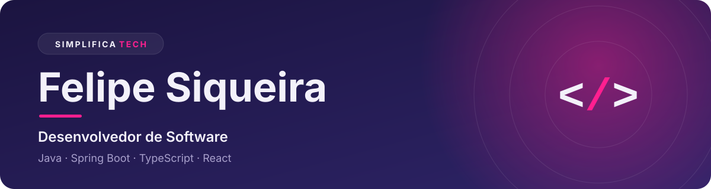
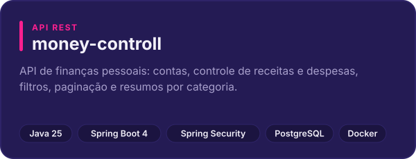
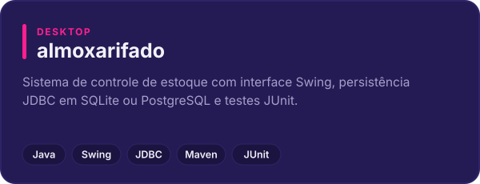
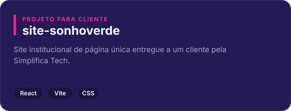
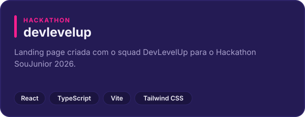

  

**Português** · [English](README.en.md)

## Sobre mim

Sou desenvolvedor de software em Marília, São Paulo, e faço parte da [Simplifica Tech](https://www.simplificatech.pro), uma consultoria que cria software sob medida, automações e sites para que as empresas gastem menos tempo lutando contra a própria tecnologia.

Programo desde 2017. Meu foco é desenvolvimento backend com **Java e Spring Boot**: APIs REST, bancos de dados e código fácil de testar e manter. Também construo front ends com **React e TypeScript**, e já atuei como voluntário implementando uma funcionalidade de pagamentos em TypeScript para uma organização sem fins lucrativos.

Falo português (nativo) e inglês (fluente).

## Tecnologias

| | |
| :--- | :--- |
| **Backend** |     |
| **Frontend** |      |
| **Bancos de dados** |    |
| **Ferramentas** |      |

## Projetos em destaque

  
  

  
  

Veja mais na minha [página de repositórios](https://github.com/fesqueira?tab=repositories).

## Estudando no momento

- **Arquitetura**: microsserviços e clean architecture
- **Qualidade**: testes automatizados e padrões de projeto
- **Dados**: aprofundando em JPA e Hibernate

## Formação

| Período | Curso | Situação |
| :--- | :--- | :--- |
| 2026 – 2030 | Engenharia de Software | Em andamento |
| 2017 – 2020 | Análise e Desenvolvimento de Sistemas | Concluído |

## Contato

Aberto a oportunidades e a novos projetos pela Simplifica Tech.

  
