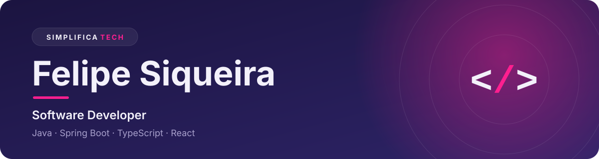
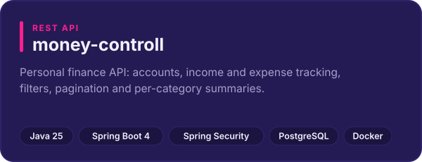
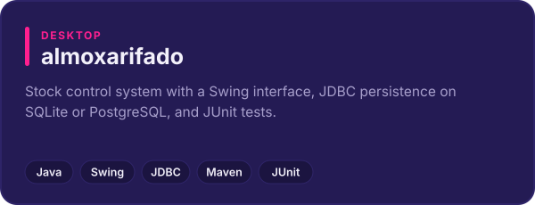
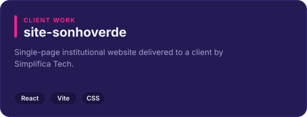
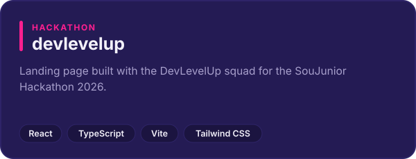

  

**English** · [Português](README.pt-BR.md)

## About me

I'm a software developer from Marília, Brazil, and part of [Simplifica Tech](https://www.simplificatech.pro), a consultancy that builds custom software, automation and websites so businesses spend less time fighting their own technology.

I've been coding since 2017. My focus is backend development with **Java and Spring Boot**: REST APIs, databases and code that is easy to test and maintain. I also build front ends with **React and TypeScript**, and I've done volunteer work implementing a payment feature in TypeScript for a non-profit organisation.

I speak Portuguese natively and English fluently.

## Tech stack

| | |
| :--- | :--- |
| **Backend** |     |
| **Frontend** |      |
| **Databases** |    |
| **Tools** |      |

## Featured projects

  
  

  
  

More on my [repositories page](https://github.com/fesqueira?tab=repositories).

## Currently learning

- **Architecture**: microservices and clean architecture
- **Quality**: automated testing and design patterns
- **Data**: going deeper into JPA and Hibernate

## Education

| Period | Course | Status |
| :--- | :--- | :--- |
| 2026 – 2030 | Software Engineering | In progress |
| 2017 – 2020 | Systems Analysis and Development | Completed |

## Contact

Open to opportunities and to new projects through Simplifica Tech.

  
